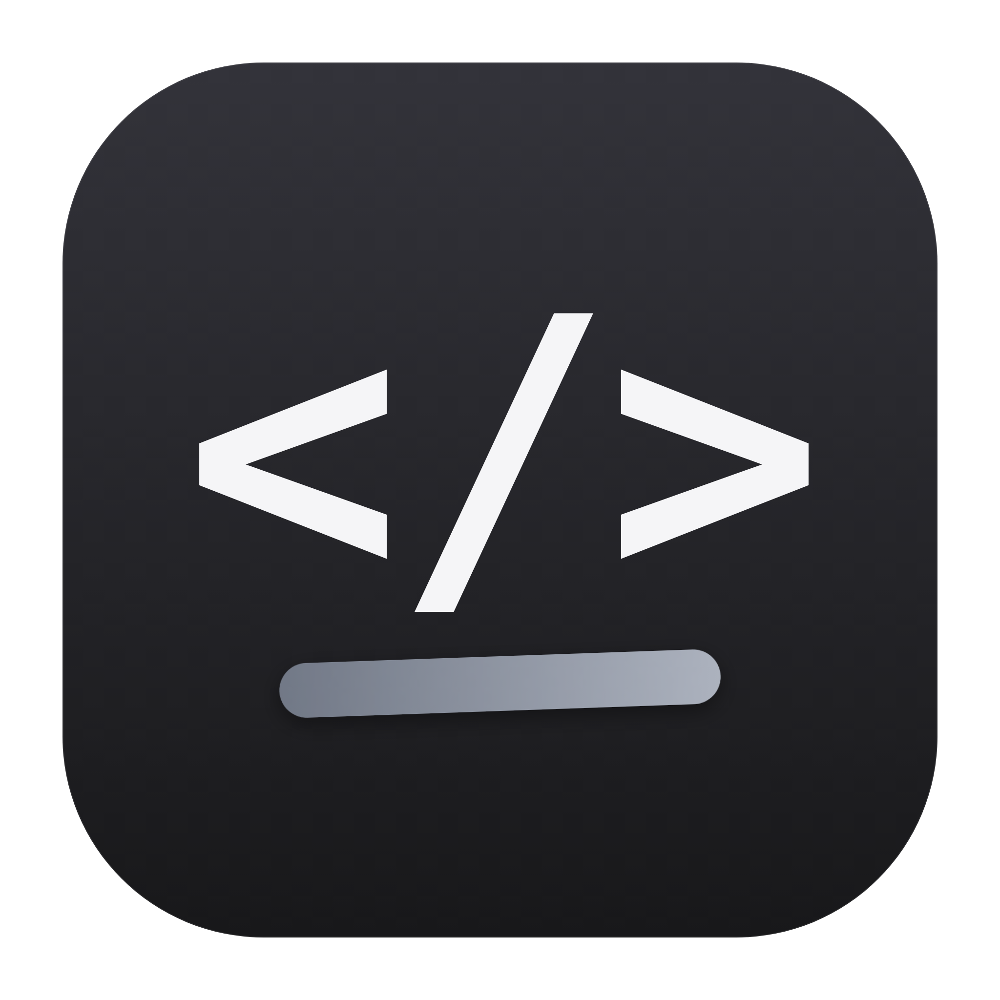

# Code Canvas

> A desktop code editor with a drawing canvas layered straight over your code — write a program, then *sketch the explanation on top of it*.

Code Canvas is a learning and teaching tool that lives on your machine. The editor and the canvas share **one surface**: the drawing layer sits transparently above the code, so you can annotate a loop, trace variables, or diagram an algorithm right next to the line it belongs to — then export the whole thing as a single image.

It is a real editor, too: multi-file projects with a file tree, a genuine shell in the output panel that accepts program input, and a runner that compiles and executes **many languages** using the toolchains already installed on your computer.

```
┌───────────────────────────────────────────────────────────┐
│  Code Canvas        [ Code | Draw ]        Save   Run      │
├──────────────┬────────────────────────────────────────────┤
│  Explorer    │  main.py                              ●    │
│   ▸ src/     │                                            │
│   ▸ main.py  │  for i in range(5):    ╭───────────────╮   │
│   ✎ notes.py │      print("i =", i) ─▶│  runs 5 times │   │
│              │                        ╰───────────────╯   │
├──────────────┴────────────────────────────────────────────┤
│  Terminal                    ▶ Run types the command here  │
│  $ python3 main.py                                         │
│  i = 0                                                     │
│  i = 1  …                                                  │
└───────────────────────────────────────────────────────────┘
```

---

## Features

- **Draw on your code.** A transparent [Excalidraw](https://excalidraw.com/) canvas sits over the [Monaco](https://microsoft.github.io/monaco-editor/) editor. One key flips which layer receives input. No license key and no watermark — the drawing engine is MIT.
- **Multi-file projects.** A real file tree — create files and folders, rename, and delete to the Trash. Tabs, unsaved-change dots, and *Save all / Close all*.
- **A real terminal.** The output panel is an [xterm.js](https://xtermjs.org/) terminal backed by a genuine login shell ([node-pty](https://github.com/microsoft/node-pty)). **Run** types your command into that shell, and you can type back to answer `input()` prompts — real stdin, not a mock.
- **Runs many languages** using toolchains already on your `PATH` — Python, Node/JavaScript, Ruby, PHP, Go, C, C++, Rust, and Java. Compiled languages build to a temp binary and run.
- **Per-file drawings** are saved with the project, so your annotations travel with the code.
- **Export** the combined *code + sketch* as a PNG snapshot, or the drawing alone as PNG or SVG.
- **Remembers your session** — last project, open tabs, mode, terminal height, and window size are restored on launch.
- **A native macOS feel** — hidden-inset title bar, native vibrancy behind the chrome, and a dark palette shared by the editor, terminal, and canvas.

---

## Tech stack

| Layer | Choice |
|-------|--------|
| Shell | Electron 44 |
| Build | electron-vite 6 + Vite 8 |
| UI | React 19 |
| Editor | Monaco Editor (`@monaco-editor/react`) |
| Canvas | Excalidraw (MIT) |
| Terminal | `@xterm/xterm` + node-pty |
| Packaging | electron-builder (`.dmg`) |

---

## Requirements

- **macOS** on Apple silicon (the packaged build targets `arm64`).
- **Node.js 18+** to build and run from source.
- At least one language toolchain on your `PATH` (e.g. `python3`, `node`, `clang++`, `go`, `rustc`). The app detects what you have and reports it in the sidebar.

> Java note: macOS ships `/usr/bin/java` and `/usr/bin/javac` as *stubs* that only prompt you to install a JDK. Code Canvas detects that and tells you to install a real JDK (e.g. `brew install openjdk`) instead of failing cryptically.

---

## Install

Grab the latest `Code Canvas-<version>-arm64.dmg` from the project's Releases
page, open it, and drag **Code Canvas** into **Applications** — then launch it.

The build is **not code-signed** (no Apple Developer certificate is configured),
so Gatekeeper warns on the first launch:

- **Right-click the app → Open**, then confirm; or
- clear the quarantine flag once:

  ```bash
  xattr -dr com.apple.quarantine "/Applications/Code Canvas.app"
  ```

Each release ships checksums, so you can verify a download first:

```bash
shasum -a 256 -c SHA256SUMS.txt
```

---

## Build from source

```bash
# 1. Install dependencies
npm install

# 2. Build the native terminal module against Electron
npm run rebuild

# 3. Start the app in development
npm run dev
```

`npm run rebuild` is only needed the first time (and again after you reinstall `node_modules`) — node-pty is a native module and must be compiled for Electron's ABI.

### Scripts

| Command | What it does |
|---------|--------------|
| `npm run dev` | Launch the app with hot reload |
| `npm run build` | Compile main, preload, and renderer into `out/` |
| `npm run rebuild` | Rebuild node-pty for Electron |
| `npm run icon` | Regenerate `build/icon.icns` from the rendered SVG |
| `npm run dmg:art` | Re-render the `.dmg` window artwork at 1x and 2x |
| `npm run pack` | Unpacked `.app` in `release/` — quick packaging smoke test |
| `npm run dist` | Build the distributable **`.dmg`** into `release/` |
| `npm run checksums` | Write `release/SHA256SUMS.txt` for the built artifacts |

After `npm run dist` you'll find the installer and its checksums at:

```
release/Code Canvas-<version>-arm64.dmg
release/SHA256SUMS.txt
```

---

## Using it

1. **Open Folder…** to pick a project — or choose one from the **Recent** list on the welcome screen.
2. **Write code.** Open files from the Explorer; they appear as tabs.
3. **Run** (or `⌘↵`) to compile and execute the active file. It saves first, so you always run what you see.
4. **Draw** — press `⇧Tab` or click **Draw** — and sketch directly over the code.
5. **Export** a snapshot of code + sketch, or just the drawing.

### Keyboard shortcuts

| Shortcut | Action |
|----------|--------|
| `⇧Tab` | Toggle **Code ⇄ Draw** |
| `⌘↵` | Save & **Run** the active file |
| `⌘S` / `⌘⇧S` | Save / Save all |
| `⌘N` | New file |
| `⌘O` | Open folder |
| `⌘W` / `⌘⇧W` | Close tab / Close window |

**In the Explorer:** `↑`/`↓` move, `→`/`←` expand & collapse, `Enter` opens, `F2` renames, `Delete` moves to the Trash. Right-click any entry for the context menu.

---

## Project structure

```
code-canvas/
├── build/                    # icon.png master → icon.icns, plus .dmg window art
├── scripts/
│   ├── render-icon.cjs       # rasterises the SVG icon via Electron
│   ├── make-icns.sh          # PNG → .icns via sips + iconutil
│   ├── render-dmg-background.cjs  # .dmg window artwork (1x + 2x)
│   ├── sync-excalidraw-assets.cjs # self-hosts Excalidraw fonts/locales
│   └── checksums.cjs         # SHA-256 for the built artifacts
├── electron-builder.yml      # .dmg packaging config
├── electron.vite.config.mjs
├── CHANGELOG.md
└── src/
    ├── main/index.js         # window + vibrancy, FS/IPC, toolchain resolver, PTY, menu
    ├── preload/index.js      # window.api bridge (contextIsolated)
    └── renderer/
        ├── index.html
        └── src/
            ├── App.jsx       # state, session restore, file ops, menu dispatch
            ├── App.css       # themed stylesheet
            ├── index.css     # design tokens
            ├── lib/monaco.js
            └── components/
                ├── FileTree.jsx     # tree + context menu + keyboard nav
                ├── Tabs.jsx
                ├── MonacoPane.jsx
                ├── DrawCanvas.jsx   # Excalidraw wrapper (self-hosted fonts)
                ├── Terminal.jsx     # xterm
                ├── Welcome.jsx      # empty state + recent projects
                └── Dialog.jsx       # modal prompts/confirms
```

---

## How it works

**One surface, two layers.** The editor fills the workspace and the Excalidraw canvas is absolutely positioned above it. The scene background is seeded transparent (`viewBackgroundColor: 'transparent'`) so the code stays readable through the strokes. A `mode-code` / `mode-draw` class decides which layer receives pointer events:

```css
.mode-code .canvas-wrap  { pointer-events: none; } /* draw layer is inert */
.mode-draw .editor-layer { pointer-events: none; } /* editor is inert */
```

**Drawing persistence.** Each project keeps one sidecar file, `<project>/.sketch/drawings.json`, mapping a file path to that file's serialized Excalidraw scene. It's written on a short debounce as you draw, and the `.sketch` folder is hidden from the Explorer. Because the sidecar lives inside the project, drawings are versioned and shared along with the code.

**Fonts ship with the app.** Excalidraw normally fetches its drawing fonts from a CDN at runtime, which a desktop build must not depend on. `scripts/sync-excalidraw-assets.cjs` copies the fonts and locale bundles out of `node_modules` into the renderer's public folder on every `dev`/`build`, and `window.EXCALIDRAW_ASSET_PATH` points at them — so text renders identically offline.

**The terminal is a real shell.** A single persistent PTY (`id: main`) runs your login shell at the project root. **Run** resolves a toolchain, prints a labelled divider, and *types* the command into that shell — so prompts, `stdin`, colours, and `Ctrl+C` all behave exactly as they do in Terminal.app. Starting a program that reads input is the normal case, not a special one.

**Toolchain resolution.** For each language the main process tries a list of candidate executables in order (e.g. C++ tries `clang++`, then `g++`) and uses the first one actually present, caching the result. If none is found you get a plain explanation instead of a confusing shell error.

**Session restore.** Settings live in a small `settings.json` under Electron's `userData` folder: last project root, open tabs, active file, mode, terminal height, window bounds, and recent projects.

---

## Known limitations

- **macOS first.** Only the macOS `.dmg` is configured (Apple silicon). Windows/Linux would need extra packaging work.
- **No code signing.** The app is unsigned, so first launch on another Mac needs a Gatekeeper override.
- **Annotations are viewport-anchored.** Drawings don't scroll with the code, so long files read best in shorter chunks.
- **One terminal.** There's a single shell session, not a panel per project.
- **Java needs a real JDK** — the macOS stub is detected and rejected.

---

## Roadmap

- [x] **Phase A** — file management (create / rename / delete-to-Trash, context menu, unsaved-change prompt).
- [x] **Phase B** — `PATH` toolchain resolution and language runners.
- [x] **Phase C** — remember the session across launches.
- [x] **Phase D** — terminal controls, run banner, `⌘↵`/`⌘S`, tab and Explorer polish.
- [x] **Phase E** — drawing polish: clear, snapshot / PNG / SVG export, "has sketch" indicator.
- [x] **Phase F** — native menu, welcome screen with recent projects, `.dmg` packaging, docs.
- [x] **Release 1.0.0** — `.dmg` window artwork, `CHANGELOG.md`, release checksums, install docs.
- [ ] Link a shape to a line number; step-through presentation mode; a shared pointer for teaching.
- [ ] Auto-generated visuals — turn output into sticky notes, diagram a program's flow.
- [ ] Windows and Linux builds; notarised, signed macOS release.

See [`CHANGELOG.md`](CHANGELOG.md) for the release history.

---

## License

Project license: choose one and add a `LICENSE` file (MIT and Apache-2.0 are both common for a project like this). Until then, all rights reserved by the author.

The drawing engine, [Excalidraw](https://github.com/excalidraw/excalidraw), is MIT-licensed — so the app needs **no license key, no trial, and shows no watermark**. Its drawing fonts are shipped unmodified with the package under their own upstream licenses.
